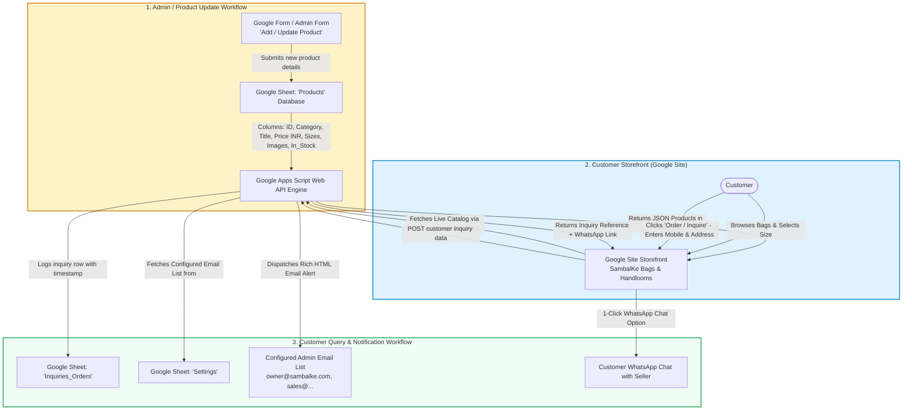

# SambalKe Handlooms - End-to-End Google Ecosystem Workflows

This directory contains the complete, production-grade workflows for **SambalKe Handlooms**, an artisanal Sambalpuri product brand starting with Sambalpuri Ikat bags and built to seamlessly scale to Sambalpuri sarees, kurtas, dupattas, and home furnishings.

---

## 🌟 Executive Summary & Core Rules

1. **Platform**: Google Sites (Storefront) + Google Sheets (Database) + Google Forms (Admin Catalog Manager) + Google Apps Script (Serverless API & Email Engine).
2. **Pricing Currency**: **Indian Rupees (₹)** exclusively.
3. **No Online Payment Gateway**: Customers **do not pay online**; instead, they submit an order inquiry with their **Mobile Number**, **Selected Product**, **Size**, and **Quantity**.
4. **Configurable Email Notification List**: When an order inquiry is submitted ("product is queried"), an email is immediately dispatched to a configurable recipient list stored in Google Sheets (`Settings` tab) without redeploying code.
5. **Catalog Expandability**: Initial focus on Sambalpuri bags (Tote, Sling, Laptop, Travel Duffel, Clutches), expandable to other categories by simply submitting the Google Form with a different category tag.

---

## 📐 Architecture Diagram



---

## 📂 Directory Structure

| Subdirectory / File | Purpose |
| :--- | :--- |
| [`01_google_sheets_setup/`](file:///Users/nsarangi1/Desktop/software_developement/POC/websites/google_sambalke/workflows/01_google_sheets_setup) | Schemas for Google Sheets: `Products`, `Inquiries_Orders`, and `Settings` (with configurable email list). |
| [`02_google_forms_admin/`](file:///Users/nsarangi1/Desktop/software_developement/POC/websites/google_sambalke/workflows/02_google_forms_admin) | Blueprint & Apps Script hook to add/update products via Google Forms into the catalog. |
| [`03_apps_script_backend/`](file:///Users/nsarangi1/Desktop/software_developement/POC/websites/google_sambalke/workflows/03_apps_script_backend) | Ready-to-paste `Code.gs` serverless REST API that powers GET catalog & POST inquiry + email dispatch. |
| [`04_notifications_and_email/`](file:///Users/nsarangi1/Desktop/software_developement/POC/websites/google_sambalke/workflows/04_notifications_and_email) | Responsive HTML email templates with 1-click customer WhatsApp & Call buttons. |
| [`05_google_site_storefront/`](file:///Users/nsarangi1/Desktop/software_developement/POC/websites/google_sambalke/workflows/05_google_site_storefront) | Embeddable Google Sites HTML/JS widget styled with authentic Sambalpuri aesthetics. |
| [`06_product_catalog_expansion/`](file:///Users/nsarangi1/Desktop/software_developement/POC/websites/google_sambalke/workflows/06_product_catalog_expansion) | Step-by-step expansion guide for sarees, kurtas, dupattas, and home textiles. |
| [`assets/`](file:///Users/nsarangi1/Desktop/software_developement/POC/websites/google_sambalke/workflows/assets) | High-resolution photography of authentic Sambalpuri Ikat tote bags, sling bags, and laptop bags. |

---

## ⚡ 10-Minute Deployment Walkthrough

### Step 1: Create the Master Google Sheet
1. Open Google Sheets ([sheets.new](https://sheets.new)).
2. Name the spreadsheet: **`SambalKe_Store_Database`**.
3. Create three tabs using the schemas in [`01_google_sheets_setup/`](file:///Users/nsarangi1/Desktop/software_developement/POC/websites/google_sambalke/workflows/01_google_sheets_setup):
   - **`Products`** (Product ID, Category, Title, Description, Sizes, Price_INR, Image_URL, In_Stock)
   - **`Inquiries_Orders`** (Inquiry_ID, Timestamp, Customer_Name, Mobile_Number, Product_Title, Size, Quantity, Total_INR, Address, Status)
   - **`Settings`** (Key-value pairs including `NOTIFICATION_EMAIL_LIST`)

### Step 2: Set Your Configurable Notification Email List
In the **`Settings`** tab of your Google Sheet, add row:
- **Setting_Key**: `NOTIFICATION_EMAIL_LIST`
- **Setting_Value**: `yourname@gmail.com, partner@gmail.com, orders@sambalke.com`
*(You can change or add emails here at any time without touching code!)*

### Step 3: Deploy the Google Apps Script API
1. In your Google Sheet, click **Extensions** $\rightarrow$ **Apps Script**.
2. Replace all code in `Code.gs` with [`workflows/03_apps_script_backend/Code.gs`](file:///Users/nsarangi1/Desktop/software_developement/POC/websites/google_sambalke/workflows/03_apps_script_backend/Code.gs).
3. Click **Deploy** $\rightarrow$ **New deployment**.
4. Select type: **Web app**.
   - **Execute as**: *Me (your Google account)*
   - **Who has access**: *Anyone* (crucial so your Google Site can fetch products & submit inquiries).
5. Click **Deploy**, authorize permissions, and copy the **Web App URL** (e.g. `https://script.google.com/macros/s/AKfycb.../exec`).

### Step 4: Create the Admin Google Form (For Adding Products)
1. Follow the field guide in [`02_google_forms_admin/README.md`](file:///Users/nsarangi1/Desktop/software_developement/POC/websites/google_sambalke/workflows/02_google_forms_admin/README.md).
2. Link the Google Form responses to the same Google Sheet, or use the provided `FormToSheetSync.gs` script.

### Step 5: Embed in Google Sites
1. Open your Google Site editor ([sites.google.com](https://sites.google.com)).
2. In the right panel, click **Insert** $\rightarrow$ **Embed (< >)** $\rightarrow$ **Embed code**.
3. Open [`05_google_site_storefront/google_site_embed.html`](file:///Users/nsarangi1/Desktop/software_developement/POC/websites/google_sambalke/workflows/05_google_site_storefront/google_site_embed.html).
4. Update line 15 with your Web App URL:
   ```javascript
   const APPS_SCRIPT_URL = "https://script.google.com/macros/s/YOUR_DEPLOYMENT_ID/exec";
   ```
5. Paste the code into Google Sites and click **Save** $\rightarrow$ **Publish**.

Now your Google Site is completely live! Customers can browse bags in ₹, request orders with their mobile number, you get instant email notifications to your configured list, and you can update products anytime via Google Form!
